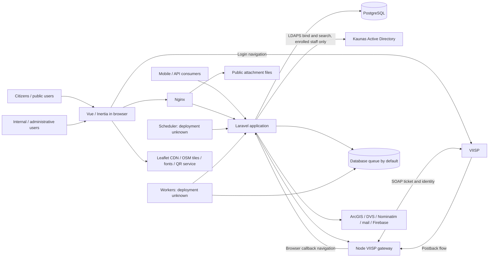

# MatauKauna architecture

## Purpose and Scope

MatauKauna lets citizens report problems in Kaunas, view published reports and statistics, and follow progress. Internal users classify, assign, review, merge, publish and resolve reports; administrators manage institutions, users, roles, content and automation. These responsibilities are evidenced by the routes and their controller/service implementations, not by the template root README.

This is a living baseline of the inspected code on 2026-09-16, updated on 2026-10-12 for the LDAP implementation. It describes current behavior: the Laravel LDAP credential boundary from [ADR-0001](adr/0001-ldap-authentication.md) now exists behind `LDAP_ENABLED` (off by default), while the ADR's remaining policy decisions stay open. Change tracking belongs in the [architecture backlog](architecture-backlog.md).

Scope includes the repository at commit `3702f59` and read-only inspection of the Compose-referenced sibling working trees `../kauno_problemos_gateway` (HEAD `a6f320f`) and `../kauno_problemos_viisp_handler` (HEAD `7056b2f`). Both siblings have local modifications; these identifiers alone do not reproduce the inspected files. No services, production database, live VIISP exchange or deployment were exercised. Production versions, effective environment values and operational topology are **Unknown / requires confirmation**. Secret files and certificate contents were not used as evidence.

## System Context



This diagram describes the inspected system and its declared runtime dependencies. The Active Directory edge is active only when `LDAP_ENABLED=true` and is reached directly from Laravel (never through the Node gateway). The Node gateway is a separate process and repository, but the supplied runtime mounts it and its handler from sibling directories. The Vue application is served by Laravel/Inertia; it is not a separately deployed API-only frontend. Mobile client source is not in this repository.

## Runtime Components

| Component | Responsibility and inputs | Outputs | Dependencies and boundary |
| --- | --- | --- | --- |
| Vue 3 / Inertia 2 / Vite | Render Laravel page props; collect forms and UI actions | Inertia navigation/forms and Axios JSON requests | `resources/js/app.js`, `Pages/Auth/Login.vue`, `bootstrap.js`, Blade root view. UI capability checks are presentation, not authoritative authorization. |
| Nginx | Receive browser/API traffic; serve existing files; forward PHP and Swagger | Static files, FastCGI responses, `/swagger/` proxy | `docker/nginx/conf.d/nginx.conf`: document root `app/public`, HTTP port 80, generic PHP location. No gateway proxy location in this file. |
| Laravel 11 / PHP-FPM 8.3 image | Route requests, authenticate, authorize and execute report/admin workflows | Inertia responses, JSON, redirects, DB writes, integration requests, jobs | `routes/web.php`, `routes/auth.php`, `routes/api.php`, controllers and services. Owns application identity records, sessions and business decisions. |
| PostgreSQL 16 | Persist users, roles/permissions, institutions/employees, reports, review history, transfers and configuration | Relational queries and state | Compose supplies `dbdata`; migrations define schema. Laravel database configuration defaults to SQLite unless `DB_CONNECTION` is set; PostgreSQL is the supplied topology and test target, not a verified production fact. |
| Session/cache/token persistence | Store web sessions, transient mobile/2FA handoffs and Sanctum tokens | Authenticated requests and expiring handoffs | Session and cache configuration default to the database; `sessions`, `cache`, `cache_locks`, `personal_access_tokens` migrations exist. Actual production stores are **Unknown / requires confirmation**. |
| Node Express gateway + VIISP handler | Accept login-init, postback and exchange HTTP calls; obtain signed SOAP tickets/identity data | VIISP redirect URL; short-lived token; normalized identity JSON | Separate VIISP protocol boundary. `utils/viisp_handler.js` creates one client promise and process-local session map. No application-user DB, RBAC or Laravel session creation was found here. |
| Scheduler and queue workers | Execute deadlines, archive/deletion, privacy, audit purge and external status pulls | Jobs, lifecycle changes, notifications and imported updates | `routes/console.php`, `app/Console/Commands`, `app/Jobs`. Database queue is default; no worker/scheduler service is defined in Compose. Some commands run work directly, others enqueue it. |
| Attachment storage | Store report and review uploads and imported GIS attachments | File paths and directly accessible URLs | Upload services write under `public/files`; Nginx serves the same host bind mount. Files are not protected by Laravel's report visibility checks when fetched directly. |
| Laravel integration services | Convert local reports/configuration into external requests and reconcile replies | ArcGIS features/attachments, DVS submissions/status, geocoding, mail and push | `ArcGisProblemTransferService`, `DvsProblemTransferService`, `KaunasAddressGeocoder`, `TransactionalMail`, `PushNotification`. Institution integration secrets use encrypted model casts and depend on the application key. |
| Swagger UI | Display OpenAPI and allow interactive API use | Requests to Laravel API | Compose service and `app/docs/openapi.yaml`; `/swagger/` is proxied without a separate access restriction in the supplied Nginx file. `UseSwaggerAuthorizationHeader` accepts `X-Authorization` as a fallback bearer header. |

Paths in this table below `resources`, `routes` or `app/Services` are relative to the Laravel directory `app/`.

### Runtime and deployment assumptions

[Compose](../docker-compose.yml) defines gateway, Nginx, PHP, PostgreSQL and Swagger on an externally created `proxy` network. It publishes gateway port 3000 and database port 5433, and mounts source into running containers. PHP exposes development/debug ports 5174 and 9003; [Vite](../app/vite.config.js) actually configures 5173. `depends_on` lists startup dependencies but no readiness healthchecks are declared.

The [PHP image](../Dockerfile) installs Node/npm, Composer, GD, Imagick, Xdebug and, since 2026-10-12, `ext-ldap`; it does not build an immutable application release. Composer's `dev` script starts a development queue listener but no scheduler. TLS termination, callback ingress, process supervision, build pipeline, backups, restore testing, production replica counts and service owners are **Unknown / requires confirmation**. The minimal `.env.example` does not specify database, queue, session or VIISP settings; gateway URL defaults use loopback, which cannot reach another container from PHP. See ARCH-007, ARCH-014 and ARCH-017.

## Current Authentication Architecture

Authentication establishes the user identity. Authorization determines allowed actions and data scope after authentication. The current implementation partly couples them through staff-role eligibility and login-tab checks.

### Shared user and credential model

All inspected login paths use [`App\Models\User`](../app/app/Models/User.php) and the `users` table. The model has a hashed local `password`, optional unique `viisp_personal_code_hash`, `viisp_local_password_set_at`, email-verification state, encrypted TOTP secret, role relations and institution association. `Employee` is a separate assignment/team record, not an authentication provider; it is associated with users through email lookups.

[`config/auth.php`](../app/config/auth.php) defines a `web` session guard with an Eloquent user provider. Sanctum's `HasApiTokens` and `auth:sanctum` secure API calls. There is no LDAP guard, user provider, package or separate staff model: LDAP is a credential verifier only. `users.ldap_source` / `users.ldap_username` / `users.ldap_linked_at` record the explicit, administratively provisioned directory binding of an enrolled staff account (unique pair; NULL means not enrolled). Browser login does not issue a Sanctum token; API login does.

### Public / citizen authentication: VIISP browser flow

The actual flow is in [`ViispAuthController`](../app/app/Http/Controllers/Auth/ViispAuthController.php), the sibling gateway's `controllers/viisp_controller.js`, and the handler's `dist/client.js` / `dist/utils.js` selected by its package entry point.

```mermaid
sequenceDiagram
    actor B as Citizen browser
    participant L as Laravel
    participant N as Node gateway
    participant V as VIISP
    participant D as Application database
    B->>L: GET /viisp/redirect
    L->>N: POST /gateway/viisp/login (postbackUrl, callbackUrl, exchangeSecret)
    N->>V: Signed SOAP initAuthentication
    V-->>N: Ticket
    Note over N: Store ticket, callback and secret in process memory
    N-->>L: redirectUrl
    L-->>B: Redirect to VIISP
    B->>V: Authenticate through VIISP
    V-->>N: Postback flow to /gateway/viisp/postback/:id
    N->>V: Signed SOAP getAuthenticationData(ticket)
    V-->>N: Identity data
    Note over N: Normalize identity; store 120-second exchange token
    N-->>B: Navigate to Laravel callback with token
    B->>L: GET /viisp/callback?token=...
    L->>N: GET /gateway/viisp/exchange/:token + X-Viisp-Exchange
    N-->>L: Identity; consume token
    L->>D: Match identity hash, then email; link/sync existing user
    alt New identity with no matching user
        L-->>B: Terms and registration forms
        B->>L: Accept terms and supply registration details
        L->>D: Create reporter with random local password; request email verification
    end
    L->>L: Auth::login; regenerate session; record login and active role
    L-->>B: Intended URL or dashboard
```

The gateway supports GET and POST postbacks. POST returns HTML that navigates the browser to Laravel; GET uses a 303 redirect. The exact VIISP-side postback delivery arrangement in production is **Unknown / requires confirmation**.

Laravel first matches `hashedCode` to `viisp_personal_code_hash`, then looks up the provided email (or a synthetic `viisp.<hash>@viisp.local` address). Email linking rejects a conflicting existing VIISP hash but does not restrict the user to reporter-only roles. It adds the reporter role without removing staff roles and marks an existing password usable. New browser users pass through encrypted session-held registration data, terms acceptance and profile completion. `verified` middleware still gates protected application routes.

VIISP login can therefore also authenticate an existing staff account. `AuthenticationTest::test_viisp_login_restores_saved_active_role` explicitly covers a staff user. The VIISP finalizers do not call `TwoFactorService`; do not describe VIISP as an enforced citizen-only authentication boundary (ARCH-001).

**Handler artifact caveat:** `package.json` selects `dist/index.js`. The inspected compiled client sets the SOAP endpoint to the WSDL URL and reads the key path into both certificate fields; it does not contain the `ClientSSLSecurity` setup present in `src/client.ts`. Compiled identity handling requires a personal code; source also supports company identity and additional contact formats. Both derive `hashedCode` using MD5. The gateway image does not explicitly build the handler, and Compose mounts that sibling package. What artifact production actually executes is **Unknown / requires confirmation** (ARCH-002). The handler's `getValidatedIdentity` performs data normalization/field checks; a `validate` signature helper exists but is not invoked by the inspected `getIdentity` path. Do not infer response-signature validation from its name.

### Public / citizen authentication: mobile VIISP and local passwords

[`ViispApiController`](../app/app/Http/Controllers/Api/ViispApiController.php) accepts `POST /api/viisp/init`, stores a random state with `redirect_uri`, device name and remember preference for 600 seconds, then uses the same gateway login-init call. It sets the callback to `/viisp/mobile-callback?state=...`; `/api/viisp/callback` is another route to that callback method.

The callback consumes state, exchanges the gateway token and performs similar user mapping. Existing users receive a Sanctum bearer token **directly in JSON**. New identities receive a 600-second registration token; `POST /api/register` with `viisp_registration_token` completes creation and returns a bearer token. Success does not redirect to the supplied deep link. `/api/viisp/exchange` reads a separate `viisp_mobile_exchange:` cache entry, but no producer for those entries was found (ARCH-015). Native-app handling of browser callback JSON is **Unknown / requires confirmation**.

Citizens also have local email/password registration and login through `/register`, `/login` and their API counterparts. `canAuthenticateWithEmailPassword()` disables this login for VIISP-linked users until `viisp_local_password_set_at` is present. Profile password-setting can enable it. Web registration sends verification and redirects to login; API registration immediately issues a token, with verification enforced on protected feature routes. Forgotten-password link requests are restricted to staff by `canRequestPasswordResetLink()`.

### Internal / administrative authentication

1. `Pages/Auth/Login.vue` submits email, password, remember preference and `login_type=darbuotojas` to `POST /login`. Both request validation and the input require an email despite the UI's name-or-email wording.
2. [`LoginRequest::authenticate`](../app/app/Http/Requests/Auth/LoginRequest.php) normalizes the identifier, applies a five-attempt limiter and asks [`StaffCredentialAuthenticator`](../app/app/Services/Auth/StaffCredentialAuthenticator.php) whether the attempt is LDAP-verified. That is the case only when `LDAP_ENABLED=true`, the login type is staff, and the identifier is a directory account name or the email of an enrolled account. LDAP attempts perform one `ldaps://` bind with the configured bind template, search the bound user's entry, map it to the linked `User` and call `Auth::login`; any directory failure (bad password, outage, unmapped identity) is the generic login error with no local-password fallback. All other attempts keep the local-password path: eligibility check and `Auth::attempt` against the stored hash. Both branches then share the blocked-user check and the login-type rule (`hasStaffRole()` for staff; any assigned role except `ROLE_REPORTER`, including custom roles, counts as staff). A non-email identifier is accepted only while LDAP is enabled.
3. [`AuthenticatedSessionController`](../app/app/Http/Controllers/Auth/AuthenticatedSessionController.php) prepares TOTP. If required, it logs out the initially authenticated user and stores pending-user/remember data in the session. [`TwoFactorChallengeController`](../app/app/Http/Controllers/Auth/TwoFactorChallengeController.php) verifies the code before `Auth::login`. Otherwise login completes immediately. Completion regenerates the session and records login activity and the preferred active role.
4. `POST /api/login` in [`AuthApiController`](../app/app/Http/Controllers/Api/AuthApiController.php) uses the same `StaffCredentialAuthenticator` decision and LDAP verification as the web path; otherwise it looks up the user and calls `Hash::check` as before. It applies equivalent login-type and (local path only) local-password eligibility checks, then either returns a 10-minute pending 2FA token or creates a Sanctum personal access token. `POST /api/two-factor/challenge` finishes that challenge. The API login has no matching explicit limiter in its route/controller, unlike `LoginRequest`.

Staff are provisioned through `RbacService::createUser`, invitation acceptance and seeders. These write local users/passwords and assigned roles; institution records may create/update a separate `Employee`. New staff provisioned by RBAC/invitations have TOTP enabled by `TwoFactorService`. LDAP enrollment is a separate administrative step (`php artisan ldap:link-user`) that links an existing staff user to a directory account name; it assigns no role, and no user is created from a directory login. `php artisan ldap:check` reports the non-secret LDAP configuration and performs an anonymous RootDSE read.

Other session-creation paths matter: invitation acceptance directly calls `Auth::login`, and the signed `/email/verify/{id}/{hash}` handler verifies email and logs in an unauthenticated visitor. Neither invokes the normal TOTP challenge. Email verification can also clear `archived_at`. These must be included in any LDAP eligibility/assurance policy, along with VIISP (ARCH-001, ARCH-005).

### Session and account lifecycle

Web sessions default to database storage and 120 minutes, with configurable remember behavior. API tokens use `session.lifetime` or the configured remembered-mobile lifetime (default 90 days), and `ExtendTokenExpiration` slides their expiry on authenticated requests. Tokens have `*` abilities, optionally `remember-session`; application permissions are still checked separately.

Logout invalidates the browser session or deletes the current bearer token. `not_blocked` middleware checks protected web/API requests. `UserBlockingService` revokes all tokens and DB sessions but permits its blocking operation only for reporter-only accounts. Archiving is not a reliable staff-disable control: browser password/VIISP login and verification can unarchive accounts. No directory lifecycle exists yet (ARCH-005).

## Authorization Architecture

Application authorization is owned by Laravel and persisted in custom RBAC tables: `user_role`, `user_role_map`, `user_role_permission` and `user_role_permission_map`. Built-in roles are system admin, problem admin, institution admin, municipality representative, employee and reporter; custom roles are supported.

[`ActiveRoleService`](../app/app/Services/ActiveRoleService.php) validates an active role against assigned roles and binds its permissions to the user for the request. Web binding is performed by `HandleInertiaRequests::share`; internal API routes explicitly use `ApplyActiveRoleContext`. Without binding, `User::permissions()` unions all assigned roles and `hasRole()` searches all roles. Selected API methods also bind context explicitly; the general API group does not install the internal group's binding middleware.

Enforcement is distributed across:

- Route middleware: `auth` / `auth:sanctum` establish identity; `verified`, `not_blocked` and `reporter.terms` enforce account/application prerequisites. `admin`, `automation` and `permission:*` use `User` capability methods. `EnsurePermission` gives `admin.access` a bypass, whereas some controller checks require the specific permission directly.
- Controllers and form requests: for example, `InternalProblemApiController::index` checks `issues.view`; `StoreProblemReviewHistoryRequest::authorize` checks editing permission and entry ownership.
- Models and services: `User::can*` helpers interpret permission strings; `ProblemScopeService` restricts named institution-admin and employee roles to institutions/assignments, including merge-parent/team membership. Custom staff roles do not automatically receive those restrictions. `ProblemHttpSupport` and review-history services separately implement reporter/public visibility.
- Vue receives active roles, permissions and capability props to control display; it cannot replace server checks.

No application policy classes or Gate registrations were found in `app/app`, `app/bootstrap` or routes. This is a custom authorization design, not an absence of authorization. Its main fragility is inconsistent role/context/scope semantics across entry points (ARCH-004); changing authentication must preserve the approved access matrix.

## Important Data Flows

| Flow | Code-traced path and architectural effect |
| --- | --- |
| Report submission | Web `/reporter/report` and API `/api/problems` reach `ReporterProblemController::reporterReportStore`: require reporter assignment, validate classification/files/location, call the Nominatim-backed geocoder, create `Problem`, store attachments, then apply assignment/publication rules. These are successive writes; there is no encompassing DB/filesystem transaction. |
| Internal report work | Controllers check capabilities and scope, update reports/merge groups and review history, then notify reporters/watchers. Web and internal API controllers share services but also contain separate workflow orchestration. |
| Public reading | Guest controllers and `ProblemMapService` filter publication/archive state; payloads contain attachment URLs. Direct file requests bypass that controller path (ARCH-003). |
| GIS / DVS transfers | `ProblemInstitutionAssignmentController` invokes Laravel services synchronously. Transfer rows retain external IDs and states; later calls skip known creations, and scheduled/manual pulls reconcile status and attachments. A remote success before local ID persistence leaves uncertain state (ARCH-008). |
| Notifications | `TransactionalMail::send` sends mail synchronously; `PushNotification` uses Firebase FCM and has `Queueable` but does not implement `ShouldQueue`. Queue-backed reminder/preview jobs exist separately. Do not assume all notifications are asynchronous. |
| Retention and automation | Scheduled commands dispatch archive/deletion/privacy/audit jobs or perform deadline/GIS/DVS work. `withoutOverlapping` protects scheduled command execution; it does not establish completion or uniqueness of subsequently dispatched jobs. DB deletion, file deletion and external-copy retention are separate concerns (ARCH-007, ARCH-012). |

## Architectural Boundaries

The current-owner column records inspected behavior. The planned-direction column contains recommendations, including the still-Proposed ADR-0001; it does not describe implemented LDAP behavior.

| Concern | Current owner | Planned direction |
| --- | --- | --- |
| Credential / external identity verification | Laravel local-password/TOTP code; Laravel LDAP verifier for enrolled staff (`LDAP_ENABLED`); VIISP with Node protocol adapter | Decide the enrolled-account population and alternative-path policy; keep the verifier narrow. |
| User persistence and identity linkage | Laravel `User`, RBAC and VIISP controllers | Keep local application user IDs; explicitly bind directory subjects without automatic email linking. |
| Application authorization | Laravel roles, permissions, active-role context, controller/service scope | Keep in MatauKauna; no implicit LDAP group-to-role synchronization. |
| Browser sessions / API tokens | Laravel session guard / Sanctum | Continue issuance only after the approved authentication and account checks. |
| VIISP SOAP, certificates, ticket exchange | Node gateway and handler | Preserve the VIISP-specific responsibility; pin/test its executable artifact. |
| LDAP transport and directory configuration | `app/Services/Ldap` (thin ext-ldap wrapper) with `config/ldap.php` | Keep Laravel-side; provide trusted CA material so `LDAP_TLS_VERIFY=true` works; no LDAP credentials routed through Node. |
| GIS, DVS, geocoding, mail and push | Laravel integration services | Retain adapters; improve delivery/reconciliation semantics incrementally. |

The browser also contacts OSM tiles, the Leaflet CDN and external font providers. TOTP setup currently contacts an external QR renderer with the secret-bearing `otpauth` URI (`TwoFactorService::qrImageUrl`); this crosses an authentication-secret boundary (ARCH-006).

## Architecture Risks

The highest-impact concerns are alternative session-creation paths with different staff assurance (ARCH-001), VIISP source/artifact drift (ARCH-002), public file access outside authorization (ARCH-003), role-dependent data-scope ambiguity (ARCH-004) and inconsistent account deactivation/activity tracking (ARCH-005). Queue execution assumptions, remote-write reconciliation and gateway handoff trust/state are tracked in ARCH-007 through ARCH-009. Detailed evidence and next actions belong in the backlog.

## Target Direction

Retain the Laravel application, Vue/Inertia UI, PostgreSQL persistence and VIISP adapter. Establish explicit authentication completion, authorization context and integration-delivery boundaries through small, separately tested changes. Centralize shared behavior where browser/API drift is demonstrated; do not replace the application or create a general identity platform.

Use the existing PostgreSQL feature tests and HTTP fakes as a starting point. Add coverage for the compiled gateway artifact, mixed identities, custom-role scopes, real queue timing and failure/replay scenarios. Current tests were inspected, not executed: the suite uses `RefreshDatabase` and includes a credential-triggered live Firebase send. An isolated test environment and explicit exclusion of external-effect tests are prerequisites (ARCH-013).

Make deployed artifacts, configuration, worker/scheduler ownership and sanitized operational signals reproducible and observable. Existing audit/transfer records are useful foundations, but do not establish end-to-end health monitoring (ARCH-014, ARCH-016, ARCH-017).

## First Planned Architecture Change

[ADR-0001: LDAP Authentication for Internal Users](adr/0001-ldap-authentication.md) remains **Proposed** for its open policy questions; [ARCH-010](architecture-backlog.md#arch-010--introduce-ldap-authentication-for-internal-users) is **In progress**. The recommended split is implemented: LDAP credential verification inside Laravel for explicitly enrolled staff, preserving application-owned users, authorization, TOTP and session/token issuance, disabled by default and without local-password fallback.

The evidence supports this proposed ownership split: **LDAP → identity authentication; MatauKauna/Laravel → user mapping, authorization, TOTP and sessions/tokens; Node gateway → VIISP only.** The gateway routes/client handle VIISP while Laravel's user model, role services, TOTP service and authentication controllers own application access. No inspected evidence contradicts that component boundary. VIISP currently reaching staff-bearing accounts is a separate authentication-method policy gap (ARCH-001), not evidence that Node owns staff authorization.

The boundary is implemented and tested against an in-memory directory; enabling it beyond a pilot still depends on the ADR's open decisions (durable subject attribute, mixed-login and alternative session paths, password-management restrictions, revocation lifecycle, TLS trust material).
